# Repository and how to run the code

Özgün Barış Kır (3676663). GitHub username: **ozgunbaris**. Repository: **mlds-rl-assignment3**, <https://github.com/ozgunbaris/mlds-rl-assignment3>.

All code is in the repository, and `README.md` lists every command. Short version (Python 3.12, run from the repository root, with `train_data.npy` and `test_data.npy` in `data/`):

```bash
python3.12 -m venv .venv && source .venv/bin/activate
pip install -r requirements.txt
python -m pytest tests -q                         # 18 mechanical checks
scripts/run_all.sh                                # every experiment, test and figure below
python -m fedavg.run --out results/try --C 0.1 --E 5 --B 20 --lr 0.5 \
    --rounds 300 --seed 0                         # Part 1.1, one model
python -m fedavg.run --out results/ray/seed0 --clients-per-round 4 --ray   # Part 1.2
python -m fedavg.run --out results/try_noise --C 0.1 --noise-b 0.5        # Part 2
python -m fedavg.sweep --name ce                  # C x E comparison (README lists all sweeps)
python -m fedavg.validate --list                  # names of the validation experiments
python -m fedavg.gpu_checks --out results/gpu     # GPU tests R5 to R10 (needs CUDA devices)
python -m fedavg.validate --only fedsgd trace     # run two of them
python -m fedavg.make_plots                       # figures
```

Every `results/<group>/<run>` folder holds `history.csv` (one row per round), `arrays.npz` (per-client accuracy per round, selection mask, actor timings), `final_weights.pt` and `summary.json`. The numbers quoted in the test sections are in `results/validation/validation.md`.

**Compute.** All training runs of Parts 1 and 2 used the CPU of one Apple M5 laptop (10 cores, no CUDA GPU). One 300-round run with 10 clients per round takes 1 to 3 minutes on one core. The GPU tests of question 2 (R5 to R10) ran on the lab cluster as one Nomad job on node mlds-deepdish5. The job had 6 CPU cores and 2 NVIDIA RTX 5060 Ti GPUs (16 GB each) for 28 minutes. `scripts/nomad` holds the job scripts, and the README lists their commands.

**Packages.** PyTorch supplies tensors and automatic differentiation, and Ray Core supplies the actors of Part 1.2. No federated-learning package is used.

# Data

**The 100 clients hold 118 to 393 images each, and 21 of them have a class mix that a random deal of the images would not produce.** The files hold 31,825 training images from 100 writers and 3,621 held-out test images. Pixels are 32-bit floats in [0, 1] with a white page (value 1, 88.7% of all pixels) and dark ink. Labels follow the LEAF order: 0 to 9 are digits, 10 to 35 upper-case letters, 36 to 61 lower-case letters.

**Overall distribution.** Digits make up 30% of the images, upper-case letters 39% and lower-case letters 31% (FIG(data_distribution), top). The ten digits have 2.6% to 3.4% each. Letters are unbalanced: O has 1,837 images (5.8%), while j has 56 (0.18%), a ratio of 33. A classifier that always answers O scores 5.8% on the training data and 6.1% on the test data, so 5.8% is the reference for every accuracy below. The test data has nearly the same class mix: its total-variation distance (half the summed absolute difference of class shares) from the training data is 0.05.

**Five clients.** FIG(data_distribution) (bottom) shows five clients, each chosen as the extreme of one property.

| client | reason for the choice | images | classes present | TV distance from the pooled class mix |
|---|---|---|---|---|
| 25 | fewest images | 118 | 41 | 0.35 |
| 67 | most images | 393 | 60 | 0.13 |
| 36 | fewest classes | 228 | 37 | 0.31 |
| 76 | class mix closest to the pooled mix | 339 | 59 | 0.11 |
| 86 | largest share of one class (e, 35 images, 10.8%) | 325 | 54 | 0.16 |

Client 25 has mostly digits (its three largest classes are 7, 0 and 1). Client 36 has 2 to 13 images of most digits and upper-case letters and almost no lower-case letters. Clients 67, 76 and 86 resemble the pooled distribution, with e, l, t and O as their largest classes.

**All clients.** No client holds all 62 classes; the number of classes present ranges from 37 to 61 (median 56). FIG(client_class_heatmap) shows the class shares of every client. The mean TV distance between a client's class mix and the pooled mix is 0.185. A random deal of the pooled images into clients of the same sizes gives 0.157, because 318 images spread over 62 classes already produce sampling differences. Only 21 clients lie above the 99th percentile of the random deal (0.236). Those 21 clients hold 14% lower-case letters, against 35% for the other 79. The class mix is therefore close to identically distributed for four fifths of the clients, and the remaining difference between clients is handwriting style (test F4 measures its effect).

**Duplicates.** 83 training images are exact copies of another training image, 2 images occur at two different clients, and 18 test images also occur in the training data (0.5% of the test set). Test F10 reports test accuracy with and without those 18 images.

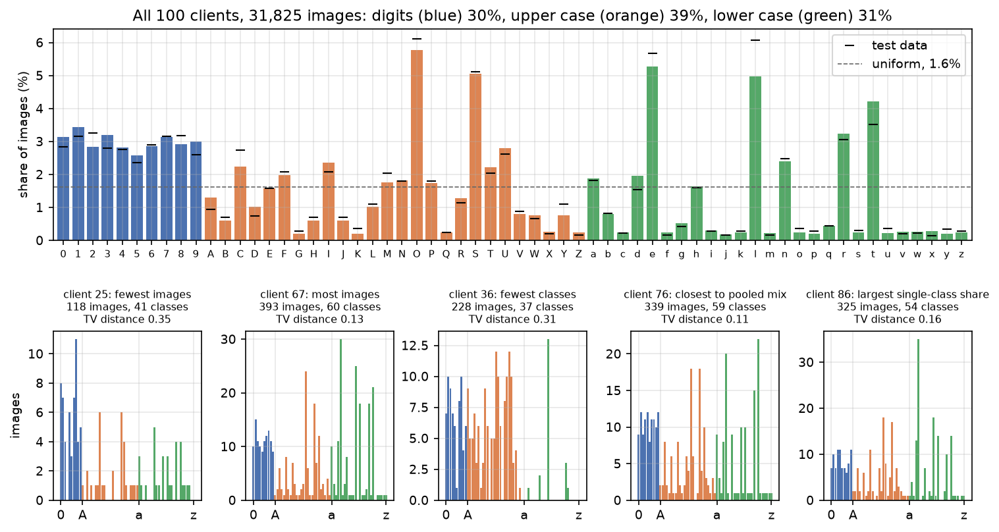{ width=100% }

{ width=100% }

# The FedAvg implementation

`fedavg/core.py` implements Federated Averaging (McMahan et al. 2017). The model is the required network: 784 inputs, 128 hidden units with ReLU, 62 outputs, 108,478 parameters stored as one flat vector $w$. One communication round $t$ does the following.

1. The server draws $m = \max(1, \mathrm{round}(C K))$ of the $K = 100$ clients uniformly without replacement.
2. Each selected client $k$ copies the global weights $w_t$ and runs $E$ epochs of minibatch SGD on its own training split, with batch size $B$ and learning rate $\eta$. Every epoch reshuffles the data, and the last, smaller batch of an epoch is used. No optimizer state survives the round.
3. The server sets $w_{t+1} = \sum_k \frac{n_k}{\sum_j n_j}\, w_k$, where $n_k$ is the number of training images of client $k$ and the sums run over the clients that returned an update.

**Choices the handout leaves open.**

- **Split.** Each client's images are split at random into 80% training and 20% validation, which gives 25,465 training and 6,360 validation images. The smallest client keeps 94 and 24, the largest 314 and 79.
- **Aggregated curves.** After every round the new global model is evaluated on the training splits and on the validation splits of all 100 clients. "Aggregated" loss and accuracy are the means over all those images, which equals the $n_k$-weighted mean of the per-client values. The alternative, averaging over the round's selected clients only, also changes with which clients were drawn; it is logged and shown in grey in FIG(main_curves).
- **Input.** The network receives $1 - x$, so the page is 0 and ink is 1 (test F7 compares three input scalings).
- **Test data.** The test file is read once per run, after the last round. Every hyperparameter was chosen on validation accuracy.
- **Randomness.** The run seed fixes the initial weights and the client sampling. The shuffling seed of a client update is derived from (run seed, round, client), so an update does not depend on which process executes it.

# Part 1, question 1: FedAvg on Federated EMNIST

## Setup and choice of learning rate and batch size

**Learning rate 0.5 with batch size 20 gives the highest validation accuracy of a 24-point grid.** The grid used $C = 10\%$, $E = 5$, 300 rounds and seed 0 (FIG(tune_heatmap)). Validation accuracy over rounds 281 to 300 rises with the learning rate up to 0.5 (0.809 at $B = 20$, 0.807 at $B = 10$, 0.799 at $B = 50$) and falls beyond it. At learning rate 2 the runs with $B = 10$ and $B = 20$ end at 5.7% and 11.4%, which is the majority-class level. The three best cells differ by less than the standard deviation over seeds measured below (0.003), so the choice among them is not significant. $B = 20$ was taken because it needs half the SGD steps of $B = 10$.

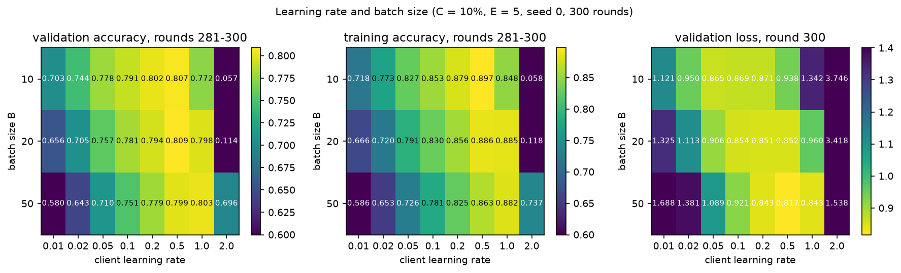{ width=100% }

## Results

**Loss and accuracy per round.** With $C = 10\%$, $E = 5$, $B = 20$ and $\eta = 0.5$, validation accuracy reaches 74.4% after 50 rounds, 78.1% after 100 rounds and 80.5% after 300 rounds (mean of 5 seeds, FIG(main_curves)). Training accuracy keeps rising to 88.6%. The validation loss has its minimum between rounds 138 and 190 (0.829 on average) and then rises to 0.872 at round 300, while validation accuracy stays flat. The model therefore overfits in loss after about round 165; the accuracy, which is the required metric, does not degrade.

| seed | training accuracy | validation accuracy | training loss | validation loss | test accuracy |
|---|---|---|---|---|---|
| 0 | 0.8879 | 0.8082 | 0.373 | 0.852 | 0.8078 |
| 1 | 0.8839 | 0.8011 | 0.381 | 0.892 | 0.8012 |
| 2 | 0.8869 | 0.8044 | 0.363 | 0.862 | 0.8092 |
| 3 | 0.8834 | 0.8036 | 0.373 | 0.864 | 0.8028 |
| 4 | 0.8860 | 0.8052 | 0.378 | 0.887 | 0.8053 |
| mean (std) | 0.8856 (0.0019) | 0.8045 (0.0026) | 0.374 | 0.872 | 0.8052 (0.0033) |

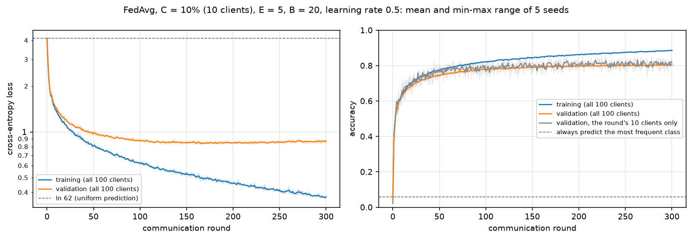{ width=100% }

**Client fraction C.** More clients per round give higher and steadier accuracy, with most of the gain reached at 5 clients (FIG(ce_curves), FIG(ce_final)). At $E = 5$ the validation accuracy over rounds 281 to 300 is 0.699 for $C = 1\%$, 0.774 for 2%, 0.800 for 5% and 0.804 for 10%. With one client per round the global model is that client's local model, so it is fitted to one writer. Its validation accuracy moves with a standard deviation of 0.021 from round to round, against 0.003 for 10 clients. No run with $C = 1\%$ reaches 75% validation accuracy in 300 rounds. Runs with $C = 10\%$ need 54 rounds at $E = 5$.

**Local epochs E.** More local epochs reach a given accuracy in fewer rounds, and they widen the difference between training and validation accuracy. At $C = 10\%$ the number of rounds to 75% validation accuracy falls from 100 ($E = 1$) to 73 ($E = 2$), 54 ($E = 5$) and 49 ($E = 10$). Final validation accuracy is 0.800, 0.805, 0.804, 0.800 and 0.798 for $E = 1, 2, 5, 10$ and 20. Training accuracy minus validation accuracy grows from 0.055 at $E = 1$ to 0.087 at $E = 20$, and the final validation loss grows from 0.714 to 1.086. Per unit of client computation $E = 1$ is the most efficient setting (FIG(ce_compute)). At $C = 10\%$ the clients process 0.26 million training samples to reach 75% with $E = 1$, 0.69 million with $E = 5$ and 2.55 million with $E = 20$. Local epochs beyond the first move each client toward its own data, and averaging cancels part of that movement (test F11).

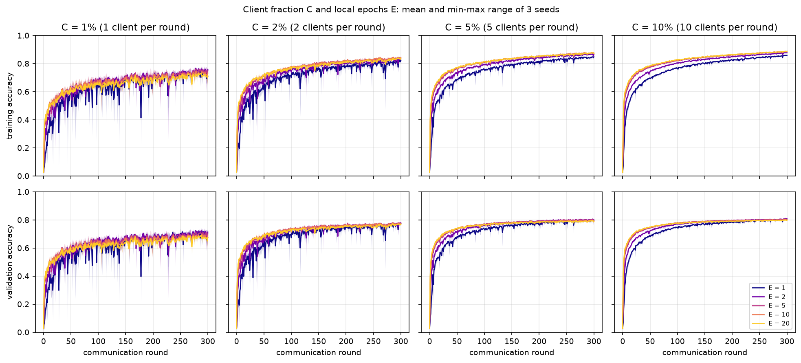{ width=100% }

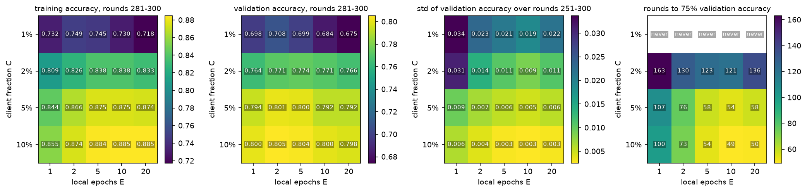{ width=100% }

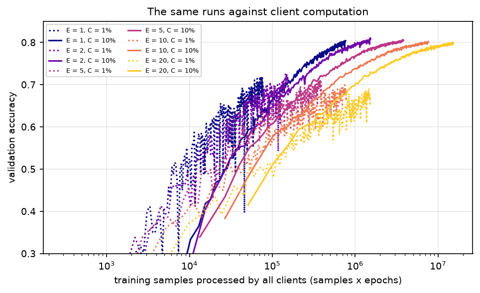{ width=62% }

**Chosen hyperparameters and test accuracy.** The chosen setting is $C = 10\%$, $E = 5$, $B = 20$, $\eta = 0.5$ and 300 rounds. $C = 10\%$ has the highest validation accuracy for every $E$. Among $E = 1, 2, 5$ at $C = 10\%$ the validation accuracies (0.800, 0.805, 0.804) differ by at most 0.005, while the standard deviation over seeds is 0.003 to 0.005. $E = 5$ reaches 75% in 26% fewer rounds than $E = 2$, and communication rounds are the cost that FedAvg is designed to reduce. **The test accuracy of the five models trained with this setting is 80.5% on average (80.1% to 80.9%).** The test data was evaluated once per model, after round 300.

## Edge cases (question 1)

- **Unequal client sizes.** Training splits range from 94 to 314 images. The server weights each client by $n_k / n$, which the handout permits because the server knows the sample counts. Test F1 shows that this weighting, and not $1/m$, reproduces gradient descent on the pooled data. On the real data the two rules give 0.8046 and 0.8071 validation accuracy (test F8), because the sizes differ by a factor of 3 only.
- **Classes missing inside a client.** 2,003 client-class pairs consist of a single image, so a per-class 80/20 split is impossible. The split is random, with at least one validation image per client. As a result 433 of the 6,360 validation images (6.8%) belong to a class of which their own client has no training image. A client trained alone classifies none of them correctly; the FedAvg model classifies 47.8% of them correctly, against 83.2% of the other validation images (test F5). Those images can only be learned from other clients, which is the purpose of federation.
- **Small validation sets.** The smallest client has 24 validation images, so one image changes its accuracy by 4.2 percentage points. The reported curves pool all images, which weights each client by its size. Per-client validation accuracy of the final model (seed 0) ranges from 0.33 to 0.91, with 10th and 90th percentiles 0.70 and 0.89.
- **A client the global model cannot fit.** Client 25 (118 images, mostly digits) has 33% validation accuracy and 37% accuracy on its own training split under the final global model. Its low training accuracy shows that the cause is its handwriting and class mix, since a merely small validation set would leave training accuracy high.
- **Batch size and data size.** A batch size larger than the client's data gives one full-batch step per epoch, and the last incomplete batch of an epoch is used. Both cases, a client with one image and a client with no image, are covered by `test_client_update_edge_cases`.
- **Client fraction.** $C K$ is rounded and limited to 1 to $K$. $C = 1\%$ gives one client; the average of one model is that model.
- **Clients not yet selected.** After 10 rounds 26 to 36 clients have never been selected (expected: 34.9, test F6). Their accuracy still rises with the global model: in rounds 1 to 10 the validation accuracy of non-selected clients gains 0.056 per round (FIG(client_heatmap)).
- **Unstable local steps.** At $\eta = 0.5$ a single late minibatch step can leave a client with a poor final model. In round 1 of seed 0, client 96 returns a model with 14% accuracy on its own data although its mean loss over the last epoch is 1.83 (test F2). Its weight in the average is 0.084, and the averaged model reaches 34% validation accuracy in that round. A client whose weights are not finite is excluded by the server (`test_client_update_edge_cases`, test R3).
- **Learning rate too large.** At $\eta = 2$ the model ends at the majority-class rate. The grid includes this value to show that 0.5 lies below the unstable range.
- **Overfitting.** The validation loss rises after about round 165 while accuracy is flat. A decaying learning rate was tested as a remedy (test F9).
- **Test data.** Selecting anything on test accuracy would use the test data for training decisions. The code reads the test file once per run, after training. The 18 test images that also occur in the training data change test accuracy by at most 0.0004 (test F10).
- **Input range.** The stored page value is 1, which gives every first-layer unit a large constant input. The network receives $1 - x$ instead (test F7).

## Tests that validate correctness (question 1)

Each test states what a correct implementation must produce and then measures it. `python -m fedavg.validate --only <name>` reruns one test and rewrites `results/validation/<name>.md`.

**F1. FedSGD limit (`fedsgd`).** With all 100 clients, $E = 1$ and full-batch steps, the $n_k$-weighted average of the client models is exactly one gradient-descent step on the pooled training loss. After 20 rounds at $\eta = 0.5$ the FedAvg weights differ from the weights of 20 centralized gradient-descent steps by at most $1.9 \times 10^{-16}$ in 64-bit arithmetic and $6.5 \times 10^{-6}$ in 32-bit arithmetic. The weights themselves moved by up to 0.26. The same run with $1/m$ weights differs from centralized gradient descent by $5.5 \times 10^{-3}$, so the test can fail and it distinguishes the two weightings.

**F2. The first 10 rounds (`trace`).** The table lists, for each of the first 10 rounds, the selected clients, the local loss, the global loss before and after the server step, and the step sizes. Four predictions hold. (1) The first minibatch loss of every client in round 1 is between 4.10 and 4.15; an untrained 62-class model must give $\ln 62 = 4.127$. (2) Each client makes $E \lceil n_k / B \rceil$ SGD steps. (3) An independent numpy recomputation of $\sum_k (n_k / n) w_k$ matches the server's weights to $9 \times 10^{-8}$ (32-bit rounding). (4) The global training loss falls in every one of the 10 rounds, from 4.122 to 1.337.

| round | selected clients | local loss, first step to last epoch | global training loss, before to after | validation accuracy | mean client step | server step | ratio |
|---|---|---|---|---|---|---|---|
| 1 | 12 13 16 19 35 43 47 54 63 96 | 4.125 to 1.645 | 4.122 to 2.834 | 0.340 | 8.52 | 5.61 | 0.66 |
| 2 | 23 32 34 35 37 50 53 65 93 95 | 2.929 to 1.030 | 2.834 to 2.211 | 0.445 | 8.12 | 4.84 | 0.60 |
| 3 | 3 23 39 40 56 57 74 76 80 91 | 2.171 to 0.623 | 2.211 to 1.871 | 0.522 | 6.75 | 3.53 | 0.52 |
| 4 | 8 33 44 55 68 70 80 83 92 94 | 1.645 to 0.605 | 1.871 to 1.731 | 0.553 | 6.66 | 3.11 | 0.47 |
| 5 | 14 26 27 30 31 39 67 80 84 85 | 1.734 to 0.460 | 1.731 to 1.621 | 0.573 | 6.00 | 2.49 | 0.42 |
| 10 | 14 15 21 35 62 72 81 86 92 94 | 1.397 to 0.249 | 1.402 to 1.337 | 0.629 | 5.27 | 2.03 | 0.39 |

The local loss at the start of a round (2.929 in round 2) is close to the global loss after the previous round (2.834), because clients start from the global model. The local loss at the end of a round (1.030) is far below the global loss after averaging (2.211). Each client fits its own images, and the average of the ten models fits all clients less well than each model fits its own client. The last column is the length of the server step divided by the mean length of the client steps. Ten orthogonal client steps of equal weight would give 0.32 and ten identical steps 1; the measured value falls from 0.66 to 0.39 as the clients' updates become more specific to their own data.

**F3. Shuffled labels (`structure`).** The training labels are permuted inside each client, and the validation labels are left untouched. No image then carries information about its label, so the expected validation accuracy cannot exceed the share of the most frequent class, 5.8%. Measured over 300 rounds: mean validation accuracy 5.1%, final 4.3%, test accuracy 4.5%. Training accuracy on the shuffled labels rises to 12.9% and the validation loss rises from 3.80 to 5.29, which is memorisation of labels that do not transfer.

Single rounds deviate from the mean: 58 of 300 rounds lie above 5.8%, and round 9 reaches 8.4%. I examined round 9 because a permutation test on the validation labels gives at most 5.6% in 2,000 draws. In that round the model answers O for 27% of all validation images and for 46% of the true O images. The cause is that images of one character resemble each other, so the model gives them the same arbitrary answer. When that answer happens to be their class, accuracy rises, and one round later (5.9%) the answer has moved to another class. The 6,360 predictions are therefore not independent draws, which the permutation test assumes, and the mean over rounds is the appropriate statistic.

**F4. The same images dealt at random (`structure`).** The 31,825 images are dealt to 100 clients at random, keeping every client's size, and the runs are repeated (2 seeds). The prediction is that identically distributed clients agree more, converge faster and differ less in accuracy.

| E | partition | validation accuracy, round 300 | rounds to 70% validation accuracy | std of per-client validation accuracy | server step / mean client step, rounds 1-50 |
|---|---|---|---|---|---|
| 1 | real writers | 0.803 | 58 and 56 | 0.101 | 0.412 |
| 1 | random deal | 0.826 | 42 and 41 | 0.049 | 0.446 |
| 5 | real writers | 0.805 | 24 and 22 | 0.099 | 0.371 |
| 5 | random deal | 0.828 | 13 and 12 | 0.045 | 0.381 |
| 20 | real writers | 0.799 | 20 and 18 | 0.101 | 0.361 |
| 20 | random deal | 0.823 | 8 and 8 | 0.048 | 0.366 |

All three predictions hold. The random deal is 2.3 points more accurate, needs about half the rounds to reach 70% at $E = 5$, and halves the spread of accuracy between clients. The random deal also reaches the centralized reference of test F5 (0.824), so the 1.6-point distance of FedAvg from centralized training is caused by the writer partition. The step ratio moves in the predicted direction by 0.005 to 0.034 only. Most of the disagreement between client updates therefore comes from minibatch noise and from the small local datasets, which both partitions share.

**F5. Reference models (`references`).** A correct FedAvg model must beat predictors that use no federation and must stay close to centralized training of the same network.

| model | pooled validation accuracy |
|---|---|
| always the most frequent class of the pooled training data | 0.058 |
| each client's own most frequent class | 0.066 |
| each client trained alone (best of 2 learning rates and 8 epoch counts) | 0.668 |
| FedAvg, seed 0, round 300 | 0.808 |
| centralized SGD on the pooled training data (best of 4 learning rates and 60 epochs) | 0.824 |

FedAvg is 14 points above clients trained alone and 1.6 points below centralized training. Its global model is more accurate than the client's own model for 90 of the 100 clients (FIG(local_vs_fedavg)); the median gain is 14.7 points. The largest loss is 20.8 points, so federation does not help every client.

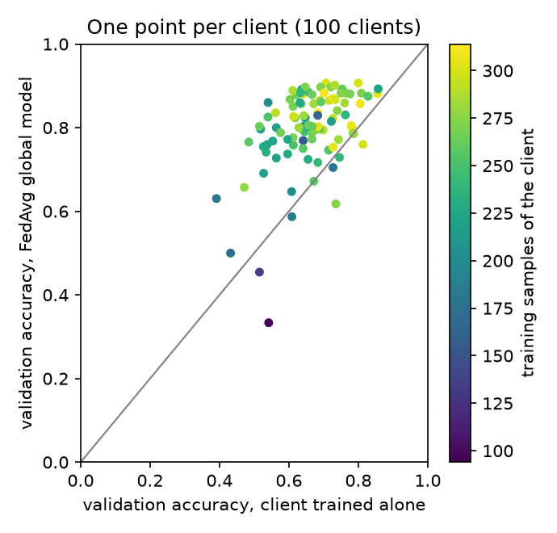{ width=52% }

**F6. Client sampling (`sampling`).** Every one of the 1,500 rounds of the five main runs has exactly 10 distinct clients. The selection counts per client over 300 rounds have mean 30 and range from 16 to 51. A chi-square test against uniform sampling gives p-values 0.60, 0.25, 0.16, 0.18 and 0.03. The smallest of five p-values is below 0.03 with probability 14% under uniform sampling, so the counts are consistent with it. The number of clients not selected in the first 10 rounds is 26 to 36, with 34.9 expected.

**F7, F8, F9. Input scaling, weighting rule and learning-rate decay (`structure`).** These runs measure how much the result depends on three choices.

*Input scaling (F7).* The three scalings are affine maps of each other, so the network can represent the same functions and any difference comes from optimisation.

| network input | page value | validation accuracy at learning rate 0.05 | at learning rate 0.5 |
|---|---|---|---|
| $1 - x$ (used) | 0 | 0.757 | 0.808 |
| $1 - 2x$ | $-1$ | 0.739 | 0.058 |
| $x$ (as stored) | 1 | 0.626 | 0.058 |

The mean squared input norm per image is 749 for the stored pixels and 755 for $1 - 2x$, against 21 for $1 - x$, and the first-layer gradient scales with the input. Learning rate 0.5 then diverges to the majority-class answer, and learning rate 0.05 ends 13 points lower. Only two learning rates were tried for the two alternative scalings, so their best possible accuracy is not established.

*Weighting rule (F8).* Over seeds 0 to 2, weights $n_k / n$ give 0.8046 validation accuracy and weights $1/m$ give 0.8071. The difference (0.0025) equals the standard deviation over seeds, as expected when client sizes differ by a factor of 3 only.

*Learning-rate decay (F9).* Multiplying the client learning rate by 0.995 or 0.99 per round lowers the final validation loss from 0.852 to 0.794 and 0.743 (seed 0). Validation accuracy stays within one standard deviation (0.808, 0.805, 0.804). Decay therefore removes most of the late rise of the validation loss without changing accuracy; the reported models use the constant rate.

**F10. Structure of the test errors (`errors`).** If the model is correct, its remaining errors should concentrate on characters that are hard for any reader of a size-normalised 28 by 28 image. The five models make 691 to 720 test errors. 12% to 14% of them confuse the upper and lower case of one letter, and a further 13% to 16% fall inside the groups {0, O, o} and {1, I, l}. With upper and lower case merged, accuracy is 82.4% to 83.4%. The most confused pairs of seed 0 are I/l (46 errors), 1/l (17), 0/O (15), C/e (14) and M/m (12). Class frequency explains much of the rest: the Spearman rank correlation between a class's number of training images and its test accuracy is 0.79.

**F11. Client drift (`drift`).** See the non-standard plots below.

## Non-standard plots (question 1)

**Per-client validation accuracy with selection events (FIG(client_heatmap)).** Each row is one client and each column one round. The colour is the accuracy of the global model on that client's validation images, and white dots mark the rounds in which the client was selected. The plot shows three things that the aggregated curve hides. All clients improve in the first 10 rounds, including those not yet selected. Accuracy differs strongly between clients at every stage, and the order of clients is stable. A client's own accuracy rises in the round in which it is selected, by 2.1 points on average in rounds 11 to 50 and by 0.8 points in rounds 151 to 300. The non-selected clients change by less than 0.1 points on average. The global model therefore moves toward the clients of the current round and partly away from the others, which is the round-to-round variation seen in the aggregated curves.

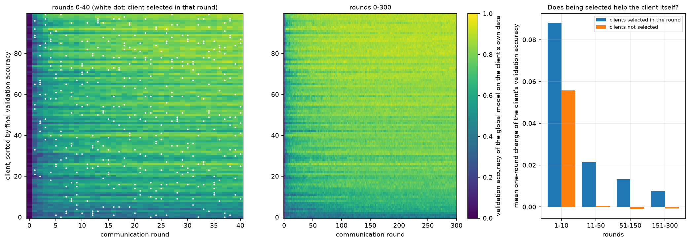{ width=100% }

**Weight-space view of the first 8 rounds (FIG(drift_pca)).** The weights of the global model and of the 10 client models of each round are projected onto their two largest principal components. Each coloured line is one client update, and each black arrow is the server step. The prediction is that more local epochs spread the client models further apart, because each client moves toward the minimum of its own loss. The measured ratio of the server step to the mean client step is 0.58 for $E = 1$, 0.49 for $E = 5$ and 0.45 for $E = 20$, and the client end points in the plot spread accordingly.

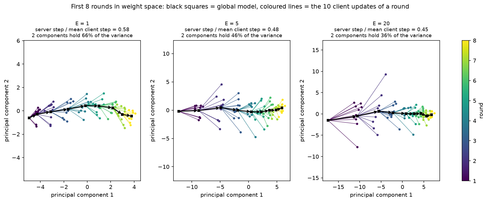{ width=100% }

## With three more months (question 1)

- **Learning rate per setting.** The learning rate was tuned at $E = 5$ and $C = 10\%$ only. I would tune it for every $(C, E)$ pair, because a longer local run tolerates a smaller step, and then repeat the comparison.
- **More seeds and split seeds.** All runs share one train/validation split. I would vary the split seed to measure how much of the 0.003 standard deviation comes from the split.
- **Drift corrections.** I would implement FedProx (a penalty on the distance from the global model) and SCAFFOLD (control variates) and test whether they raise the step ratio of F11 and the accuracy at $E = 20$.
- **Server optimizers.** I would add server momentum and FedAdam and measure rounds to 75% accuracy.
- **Per-client fairness.** The worst client has 33% accuracy. I would test local fine-tuning of the global model and per-client output-layer biases, and report the 10th percentile of client accuracy as a second metric.
- **Convergence theory check.** I would measure gradient dissimilarity between clients and compare the observed rounds-to-accuracy with the bound of Li et al. (2020) for non-identical clients.
- **Held-out writers.** The data description does not say whether the test images come from the same 100 writers. I would hold out whole clients to measure accuracy on writers the federation never saw.

# Part 1, question 2: parallel clients with Ray

## Implementation

**Each selected client runs as one Ray actor that exists for one round only.** `fedavg/ray_clients.py` defines `ClientActor` with `@ray.remote`. Its constructor receives the training split of one client, and its method `train` calls the same `client_update` function as question 1. One round does the following.

1. The server puts the global weights into Ray's object store once.
2. It creates 4 actors, one per selected client, each with `num_cpus=1` and a GPU share that depends on the number $G$ of CUDA devices. The share is 1 GPU when $G \ge 4$ and $1/\lceil 4/G \rceil$ of one GPU otherwise ($G = 0$ on the laptop, $G = 2$ on the cluster).
3. It calls `train` on every actor and collects the results with `ray.wait` as they finish.
4. It kills each actor as soon as its result is collected, and averages the returned weights with weights $n_k / n$ in client order.

**Resources.** `ray.init(num_cpus=min(cores, 4))` gives Ray 4 CPUs, and each actor reserves one. PyTorch inside an actor is limited to one thread, so an actor cannot use more than the CPU it reserved. At most 4 actors exist at any time, and a 300-round run creates and destroys 1,200 actors. An actor with a GPU share moves its client's images and the global weights to its CUDA device, trains there and returns the weights as a CPU array.

**Data.** An actor receives the data of its own client only. The driver process holds all clients' data because it simulates all 100 devices; its server code reads only weights and sample counts.

## Results

**With 4 clients per round the model reaches 79.4% validation accuracy and 79.6% test accuracy after 300 rounds, about 1 point below the run with 10 clients.** The hyperparameters are those of question 1 ($E = 5$, $B = 20$, $\eta = 0.5$), and the curves are means of 3 seeds (FIG(ray_curves)).

| quantity | 4 clients per round (Ray, 3 seeds) | 10 clients per round (question 1, 5 seeds) |
|---|---|---|
| validation accuracy at round 50 / 100 / 300 | 0.730 / 0.765 / 0.794 | 0.744 / 0.781 / 0.805 |
| training accuracy at round 300 | 0.870 | 0.886 |
| test accuracy (range over seeds) | 0.796 (0.793 to 0.800) | 0.805 (0.801 to 0.809) |
| rounds to 75% validation accuracy | 58, 66, 67 | 43 to 56 |
| standard deviation of validation accuracy within rounds 200 to 300 | 0.0074 | 0.0033 |
| lowest validation loss of the mean curve (round) and final validation loss | 0.876 (231) and 0.911 | 0.840 (165) and 0.872 |

The result lies between the values for 2 clients (0.774) and 5 clients (0.800) of question 1, as expected for 4 clients. The validation accuracy with four clients per round varies about twice as much as with ten clients. Every client was selected at least 5 times in 300 rounds (5 to 21 times, 12 expected).

**The Ray run returns the same weights as the sequential loop, and it is slower on this problem.** The final weights of seed 0 are identical in every bit to those of the sequential runner (test R1). One round takes 1.56 s with Ray and 0.083 s with the sequential loop, both including the evaluation on all 100 clients. A client's training takes 0.041 s inside its actor, while starting the four actor processes of a round takes about 1.4 s. The three runs took 474 s, 485 s and 606 s.

**On 2 GPUs the actors train on CUDA and reach the accuracy of the CPU loop, without a speed advantage.** On the cluster machine a 300-round run with GPU actors (seed 0) ends with 79.7% validation and 79.5% test accuracy. The sequential CPU loop on the same machine ends with 79.7% and 79.3%. All 1,200 updates ran on a CUDA device, 600 on each GPU (test R6). The two runs are not identical in every bit. One GPU update differs from the CPU update by at most $3 \times 10^{-7}$ per weight (test R7), and the largest weight difference grows to 0.46 after 300 rounds (test R8). A round takes 1.71 s with GPU actors against 1.28 s with CPU actors on that machine (test R9).

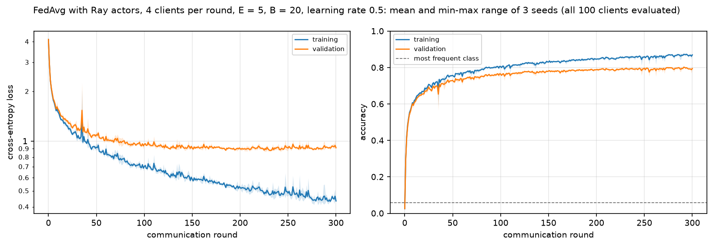{ width=100% }

## Edge cases (question 2)

- **A client process dies.** The remote call of a dead actor raises an error in the driver. The server omits that client and averages the others with weights renormalised over them (test R3).
- **A slow client.** With a round timeout the server stops waiting, kills the remaining actors and averages the updates received. A killed actor cannot deliver a late update into a later round. The reported runs use no timeout.
- **A client returns non-finite weights.** The server excludes the update, as in the sequential runner.
- **No client returns.** The server keeps the previous global model and continues with the next round.
- **Order of arrival.** `ray.wait` returns results in order of completion, which differs from run to run. The server sorts the updates by client id before averaging, so the floating-point sum has a fixed order and the result is reproducible in every bit.
- **The same client in consecutive rounds.** Client 13 is selected in rounds 1 and 2 of seed 0 and runs in two different actors (FIG(ray_gantt)). No actor outlives its round.
- **Fewer CPUs than clients.** With 1 or 2 CPUs Ray creates at most 1 or 2 actors at a time and queues the others. The weights do not change (test R4).
- **Actor start dominates.** An actor needs a new worker process that imports PyTorch. In the 300-round run the first actor of a round becomes ready 1.46 s after the last result of the previous round, and all four results arrive 0.12 s later. Parallel execution cannot shorten a round below the start time.
- **Concurrent training is slower per client.** At $E = 100$ one client's training takes 0.30 s when one actor runs and 0.62 s when four run at once. Going from 1 to 4 CPUs therefore shortens the round by a factor of 2.1, and I did not isolate the cause of the slowdown.
- **One client with a harmful update.** The largest one-round drop of validation accuracy in each of the three seeds occurs in a round that selected client 32 (rounds 262, 110 and 35; the largest is from 0.699 to 0.564). After round 50, rounds with client 32 change validation accuracy by $-0.77$ points on average (30 rounds), against $+0.06$ points for the other rounds. With 10 clients per round the same client costs 0.11 points, because its weight is about 1/10 and about 1/4 here. The accuracy returns to its previous level one round later in all three cases.
- **GPUs that do not divide the clients.** Ray places a fractional GPU request on a single device. A share of $G/m$ is 0.75 for $G = 3$ and $m = 4$, so each GPU holds one actor and only 3 of the 4 actors run at once. The code uses the share $1/\lceil m/G \rceil$, which is 0.5 in that case. On the 2 cluster GPUs with 3 clients per round, the share 0.67 ran at most 2 actors at once and took 2.75 s per round. The share 0.5 ran 3 actors at once and took 1.57 s (test R5).
- **GPU and CPU results differ in the last bits.** A GPU adds the same numbers in a different order than a CPU, so a GPU run cannot equal the sequential CPU loop in every bit. Test R1 therefore holds only when both runners use the same device type. The unit test for R1 failed on the cluster machine (15 of 16 passed), because Ray found the GPUs and the actors used them. That test now forces CPU actors, and a new test compares GPU actors with the CPU loop to a tolerance of $10^{-5}$ after 3 rounds. All 18 unit tests pass on the cluster machine.
- **Rounding differences grow during training.** With learning rate 0.5 a weight difference of $10^{-7}$ after round 1 reaches 0.05 after 10 rounds and 0.46 after 300 rounds. Two CPU runs whose initial weights differ by one rounding step separate equally fast, so the growth comes from the training problem and is unrelated to the GPU (test R8). Five runs that differ only by rounding have test accuracies of 79.3% to 79.5%. A difference below about 0.3 points between two single runs is therefore within this effect.
- **Repeated GPU runs.** Two GPU runs with the same seed gave identical weights, and the two GPUs gave identical updates. Both devices are the same model. The node's third GPU, an RTX PRO 5000, had 34 of its 48 GB in use, so two different GPU models were not compared.
- **One CUDA process per actor.** Every actor process initialises CUDA, which adds 0.33 s to its constructor and holds about 250 MiB of device memory. Four actors on one 16 GB GPU used 1,134 MiB, against 137 MiB in use before the job. The first training call of a new process also loads the GPU libraries: the same update takes 0.335 s in a new actor and 0.024 s in a warm process (test R9).
- **A failing GPU actor.** An actor process that exits during training releases its GPU share, and the next rounds train on the GPUs again. The device memory in use stayed between 751 and 771 MiB across rounds with and without failures (test R10).
- **Background load.** Seed 2 took 606 s against 474 s and 485 s for seeds 0 and 1; the operating system's file synchronisation used 2 to 3 CPUs when I checked during that run. The timings of tests R1 and R4 were taken on the same 10-core machine without control of this load.

## Tests that validate correctness (question 2)

**R1. Identical result (`ray_equal`).** A client update depends only on the global weights, the client's data and a seed derived from (run seed, round, client). The actors must therefore return exactly what the sequential loop returns. Measured on seed 0 over 300 rounds: the final weights are equal under `torch.equal`, the largest absolute difference is 0, and the per-round validation loss and training accuracy are identical. A unit test repeats this on a short run with CPU actors. The statement holds for actors and loop on the same device type; test R8 measures the difference between GPU actors and the CPU loop.

**R2. One actor per selected client per round (`ray_equal`).** The 1,200 client updates of the run were executed in 1,200 distinct worker processes, and at most 4 actors were alive at any time. All four actors of a round were alive at the same moment in 48 of the 300 rounds. In the other rounds an actor finished its 0.05 s of work before the last worker process had started. Test R4 lengthens the training to show the overlap.

**R3. Failures (`ray_faults`).** Four faults are injected into a 6-round run, and the reference is a sequential run that omits the same (round, client) pairs.

| round | injected fault | updates used | seconds | validation accuracy | server step |
|---|---|---|---|---|---|
| 1 | none | 4 of 4 | 1.0 | 0.352 | 6.60 |
| 2 | one actor process exits during training | 3 of 4 | 1.6 | 0.370 | 5.76 |
| 3 | one actor sleeps 60 s; the round waits 15 s | 3 of 4 | 15.1 | 0.469 | 4.74 |
| 4 | one actor returns non-finite weights | 3 of 4 | 1.2 | 0.518 | 4.33 |
| 5 | all four actor processes exit | 0 of 4 | 1.5 | 0.518 | unchanged |
| 6 | none | 4 of 4 | 1.5 | 0.551 | 3.83 |

The final weights are identical to the reference run and all of them are finite. Round 5 leaves the validation accuracy unchanged, and round 6 continues from the model of round 4.

**R4. CPU allocation (`ray_scaling`).** Each actor reserves 1 CPU. The prediction is that the largest number of actors training at once equals the number of CPUs given to Ray, up to 4, and that the weights never change.

| E | CPUs given to Ray | sequential loop, s per round | Ray, s per round | training s per client | most actors training at once | weights equal to sequential |
|---|---|---|---|---|---|---|
| 5 | 1 | 0.10 | 3.33 | 0.02 | 1 | yes |
| 5 | 2 | 0.10 | 2.05 | 0.03 | 2 | yes |
| 5 | 4 | 0.10 | 1.50 | 0.04 | 4 | yes |
| 100 | 1 | 1.63 | 4.90 | 0.30 | 1 | yes |
| 100 | 2 | 1.63 | 3.31 | 0.42 | 2 | yes |
| 100 | 4 | 1.63 | 2.34 | 0.62 | 4 | yes |

Both predictions hold in all six settings. Four CPUs shorten the round by a factor of 2.2 at $E = 5$ and 2.1 at $E = 100$ compared with one CPU. Ray stays slower than the sequential loop even at $E = 100$ (2.34 s against 1.63 s), because the actor start costs more than the training it parallelises. Extrapolating these numbers, four parallel actors become faster than the sequential loop when one client's training takes longer than about 0.7 s.

**R5. GPU share per actor (`gpu_checks`, section `share`).** Ray places a fractional GPU request on one device. The prediction is that a share of $G/m$ runs all $m$ actors at once only when $m/G$ is an integer, whereas $1/\lceil m/G \rceil$ always does. Probe actors that sleep 1.5 s were run on the laptop with $G$ logical GPUs; they make no CUDA call.

| actors $m$ | GPUs $G$ | share $G/m$ | actors alive at once | seconds | share $1/\lceil m/G \rceil$ | actors alive at once | seconds |
|---|---|---|---|---|---|---|---|
| 4 | 1 | 0.25 | 4 | 2.0 | 0.25 | 4 | 2.1 |
| 4 | 2 | 0.5 | 4 | 2.0 | 0.5 | 4 | 2.0 |
| 4 | 3 | 0.75 | 3 | 3.8 | 0.5 | 4 | 2.0 |
| 4 | 4 | 1 | 4 | 2.1 | 1 | 4 | 2.1 |
| 4 | 5 | 1 | 4 | 2.0 | 1 | 4 | 2.1 |
| 3 | 2 | 0.67 | 2 | 3.8 | 0.5 | 3 | 1.9 |
| 10 | 4 | 0.4 | 8 | 4.1 | 0.33 | 10 | 2.4 |

The prediction holds in all 7 cases. The comparison was repeated with real training on the 2 cluster GPUs and 3 clients per round. The share 0.5 gave 3 actors alive at once in 30 of 30 rounds, and the share 0.67 gave at most 2. Both runs ended with the same validation accuracy (0.6893), so the share changes the time and leaves the result unchanged.

**R6. The actors train on the GPUs that Ray assigned (`gpu_checks`, section `device_path`).** The prediction is that every update runs on a CUDA device, that the updates are spread evenly over the devices, and that all actors of a round are alive at once. Each setting ran 30 rounds on the cluster machine.

| setting | GPU share per actor | updates on CUDA | updates per device | rounds with all actors alive at once | largest device memory in use (MiB) |
|---|---|---|---|---|---|
| 4 clients, 2 GPUs | 0.5 | 120 of 120 | 60 and 60 | 30 of 30 | 635 |
| 4 clients, 1 GPU | 0.25 | 120 of 120 | 120 | 30 of 30 | 1,134 |
| 2 clients, 2 GPUs | 1 | 60 of 60 | 30 and 30 | 30 of 30 | 386 |
| 3 clients, 2 GPUs | 0.5 | 90 of 90 | 60 and 30 | 30 of 30 | 635 |
| 4 clients, GPUs not requested | 0 | 0 of 120 | none | 30 of 30 | not measured |

Every update had its own process in all five settings. With one GPU per actor the two actors of a round always used different devices. Ray counted the 2 GPUs of the allocation without being told their number.

**R7. One client update on the CPU and on the GPUs (`gpu_checks`, section `arithmetic`).** The batch order is drawn on the CPU from the update seed, so a GPU update must differ from the CPU update by float32 rounding only.

| client (training images) | update | SGD steps | largest weight difference, GPU against CPU | relative to the distance moved | repeat on the same GPU | GPU 0 against GPU 1 |
|----------|----------------------|------|----------------|--------------|------------|------------|
| 0 (275) | 1 full-batch step | 1 | $7.5 \times 10^{-9}$ | $4.9 \times 10^{-7}$ | identical | identical |
| 0 (275) | $E = 5$, $B = 20$ | 70 | $1.8 \times 10^{-7}$ | $2.5 \times 10^{-7}$ | identical | identical |
| 67 (314) | 1 full-batch step | 1 | $7.5 \times 10^{-9}$ | $4.5 \times 10^{-7}$ | identical | identical |
| 67 (314) | $E = 5$, $B = 20$ | 80 | $3.0 \times 10^{-7}$ | $2.8 \times 10^{-7}$ | identical | identical |

The relative difference is about one float32 rounding step ($6 \times 10^{-8}$) times a small factor, as predicted. A wrong batch order or a wrong learning rate on the GPU would give a difference near the distance moved, which is 7.7 for client 0.

**R8. A full run with GPU actors against the CPU loop (`gpu_checks`, sections `full_run` and `sensitivity`).** Both runs use 4 clients per round, 300 rounds, $E = 5$, $B = 20$, $\eta = 0.5$ and seed 0 on the cluster machine. The prediction is that the runs differ by rounding after round 1 and separate afterwards, because every later update starts from slightly different weights. The control repeats the CPU loop from initial weights that differ by one float32 rounding step, which is at most $7.5 \times 10^{-9}$ per weight.

The table gives the largest absolute weight difference between the two runs of each pair after the stated round.

| pair of runs | round 1 | round 2 | round 5 | round 10 | round 30 | round 100 | round 300 |
|------------------------------------|-----------|-----------|-----------|-----------|-------|-------|-------|
| GPU actors and CPU loop | $1.2 \times 10^{-7}$ | $1.8 \times 10^{-7}$ | 0.0033 | 0.053 | 0.13 | 0.22 | 0.46 |
| CPU loop twice, all initial weights one step apart | $8.9 \times 10^{-8}$ | $2.1 \times 10^{-7}$ | 0.0007 | 0.051 | 0.08 | 0.18 | 0.51 |
| CPU loop twice, one initial bias one step apart | $1.2 \times 10^{-7}$ | $1.8 \times 10^{-7}$ | 0.0007 | 0.051 | 0.21 | 0.20 | 0.45 |
| CPU loop twice, all weights one step apart, $\eta = 0.05$ | $6.0 \times 10^{-8}$ | $6.0 \times 10^{-8}$ | $6.7 \times 10^{-8}$ | $1.2 \times 10^{-7}$ | 0.0003 | 0.0033 | 0.014 |

The GPU run separates from the CPU run as fast as two CPU runs separate from each other. A change of one bias by $7.5 \times 10^{-9}$ is enough to produce the same separation. With a ten times smaller learning rate the difference after 300 rounds is 36 times smaller.

| run on the cluster machine | validation accuracy | test accuracy | test predictions that differ from the CPU loop | validation accuracy gap per round, largest and mean |
|---|---|---|---|---|
| CPU loop | 0.7972 | 0.7926 | | |
| GPU actors | 0.7975 | 0.7945 | 172 of 3,621 | 0.016 and 0.0019 |
| CPU loop, all initial weights one step apart | 0.7942 | 0.7940 | 192 of 3,621 | 0.017 and 0.0019 |
| CPU loop, one initial bias one step apart | 0.7989 | 0.7954 | 185 of 3,621 | 0.016 and 0.0020 |

The GPU run is as close to the CPU loop as the CPU controls are. Three further checks ran on the cluster machine. CPU actors gave weights identical to the CPU loop after 30 rounds (largest difference 0). Two GPU runs with the same seed gave identical weights. The laptop's sequential run of the same setting ends with test accuracy 0.7940 and a largest weight difference of 0.34 to the cluster's CPU loop. The per-round validation accuracy of the two machines is identical for the first 16 rounds.

**R9. Wall-clock time with CPU actors and GPU actors (`gpu_checks`, section `timing`).** A batch of 20 images through a network of 108,478 weights is a small computation. The prediction is that the fixed cost of launching each GPU operation outweighs the GPU's arithmetic speed, and that CUDA initialisation adds time to every new actor.

| $E$ | runner | seconds per round | seconds in the actor constructor | seconds of training per client |
|---|---|---|---|---|
| 5 | sequential CPU loop | 0.08 | | 0.020 |
| 5 | Ray, CPU actors | 1.28 | 0.001 | 0.192 |
| 5 | Ray, GPU actors on 2 GPUs | 1.71 | 0.333 | 0.335 |
| 5 | Ray, GPU actors on 1 GPU | 1.76 | 0.348 | 0.341 |
| 100 | sequential CPU loop | 1.58 | | 0.397 |
| 100 | Ray, CPU actors | 1.73 | 0.001 | 0.611 |
| 100 | Ray, GPU actors on 2 GPUs | 2.31 | 0.333 | 0.917 |
| 100 | Ray, GPU actors on 1 GPU | 2.55 | 0.345 | 1.126 |

GPU actors are 33% slower per round than CPU actors at $E = 5$ and at $E = 100$. Sharing one GPU among four actors costs a further 3% at $E = 5$ and 10% at $E = 100$. The table below times the same update in one warm process, which removes the start cost.

| batch size ($E = 5$, client 67, 314 images) | SGD steps | CPU seconds, 1 thread | GPU seconds | CPU time divided by GPU time |
|---|---|---|---|---|
| 20 | 80 | 0.023 | 0.024 | 0.97 |
| 200 | 10 | 0.008 | 0.003 | 2.4 |
| full batch | 5 | 0.007 | 0.002 | 4.2 |

At the batch size of this assignment the warm GPU and one CPU thread take the same time per update. The GPU is 4.2 times faster only for full-batch steps. A new actor process needs 0.19 s (CPU) or 0.34 s (GPU) for an update that takes 0.02 s warm, so per-round actors spend most of their training time on first-use initialisation.

**R10. Failing GPU actors (`gpu_checks`, section `faults`).** One actor process exits in round 2, one actor returns non-finite weights in round 4, and all four exit in round 5. The server used 4, 3, 4, 3, 0 and 4 updates in rounds 1 to 6, and all four updates of round 6 ran on CUDA. All final weights are finite. The largest difference to a CPU reference run that omits the same clients is 0.011 after 6 rounds, which matches the growth of rounding differences in test R8 (0.003 after 5 rounds).

## Non-standard plots (question 2)

**Actor timeline (FIG(ray_gantt)).** Each bar is one actor, drawn from the moment its constructor finished to the moment it returned its update; the number is the client id. The timeline shows the required structure directly: four actors per round, new actors in every round, and no actor that spans two rounds. It also shows where the time goes. The bars are 0.05 s wide and the rounds are 1.1 s apart, so the run spends more than 90% of its time starting worker processes and evaluating the global model.

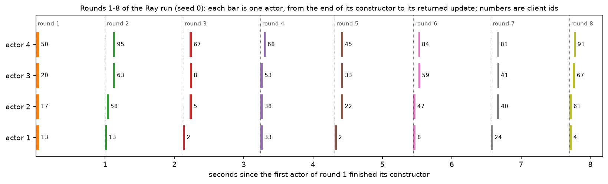{ width=100% }

**Separation of two runs that differ by rounding (FIG(gpu_vs_cpu)).** The left panel shows the largest weight difference between two runs with the same seed, on logarithmic axes. The GPU-against-CPU curve (red) and the CPU-against-CPU control (blue) rise together from $10^{-7}$ to 0.05 within 10 rounds and then grow slowly. The curve for learning rate 0.05 (green) stays near $10^{-7}$ for 20 rounds and ends 36 times lower. The right panel shows that the validation accuracy of the CPU loop and of the GPU actors differs by 0.19 points on average and by 1.6 points at most. The plot separates two explanations for a GPU result that differs from the CPU result. An implementation error would appear in round 1, whereas the measured difference starts at the size of one rounding step.

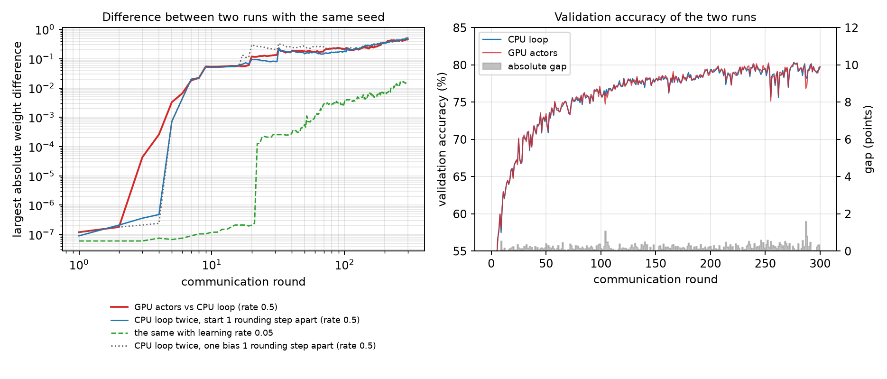{ width=88% }

## With three more months (question 2)

- **Actor reuse.** I would compare the per-round actors required here with a fixed pool of 4 long-lived actors that receive a client's data per call, and measure the time saved by avoiding 1,200 process starts.
- **Several machines.** The GPU tests used one node. I would run the actors on several nodes with one GPU each and measure the cost of shipping 108,478 weights per client per round against the training time.
- **Different GPU models.** Test R7 found identical bits on two GPUs of the same model. I would repeat it on two different models and on CPUs with several threads, and state which results stay identical.
- **Seeds against rounding.** Test R8 shows that rounding alone moves test accuracy by up to 0.3 points. I would run 20 rounding-perturbed copies of each seed and report which share of the seed-to-seed spread they explain.
- **Asynchronous aggregation.** The server waits for all actors of a round. I would implement FedAsync or FedBuff, which apply updates as they arrive, and measure accuracy under injected delays.
- **Random failures.** Test R3 injects four chosen faults. I would inject failures at random rates of 10% to 50% per client, including failure rates that depend on the client's size, and measure the bias this causes in the average.
- **Larger models.** The actor start (about 1 s) exceeds the training time of this small network. I would repeat the timing with a convolutional network, where local training dominates.

# Part 2: Laplace noise on the local data

## Implementation

**Every pixel of every local image receives one independent Laplace draw of scale $b$ before the first round.** `data.build_federation(noise_b=b)` computes $\tilde{x} = x + e$ with $e \sim \mathrm{Laplace}(0, b)$ on the stored pixel scale $[0, 1]$, and the network receives $1 - \tilde{x}$. The clients then train on the perturbed images with the unchanged FedAvg code of Part 1.

**Choices the handout leaves open.**

- **One draw per image.** The noise is drawn once and stays fixed for all rounds, which models a client that perturbs its data once and discards the clean images. A fresh draw in every epoch would release many perturbed copies of one image, and their average converges to the clean image.
- **Which data.** The training and validation splits are both local data, so both are perturbed. The test file stays clean, because it measures the final model on unperturbed inputs.
- **No clipping.** Perturbed pixels are not clipped back to $[0, 1]$; test N6 measures the clipped variant.
- **Diagnostic.** The code keeps the clean training images for one measurement only, the accuracy of the global model on them after each round ("clean training accuracy"). They never enter training.
- **Seeds.** The scales $b$ = 0, 0.02, 0.05, 0.1, 0.2, 0.3, 0.5, 0.75, 1, 1.5, 2, 3 and 5 were run with 3 seeds each at $C = 10\%$, $E = 5$, $B = 20$, $\eta = 0.5$ and 300 rounds. The noise seed equals the run seed, so the three runs of a scale differ in noise, initial weights and client sampling.

**What the noise guarantees.** Differential privacy with parameter $\varepsilon$ limits the ratio of the probabilities of any output under two candidate inputs to $e^{\varepsilon}$. Releasing $\tilde{x}$ satisfies it with $\varepsilon = \lVert x - x' \rVert_1 / b$ for two candidate images $x$ and $x'$ (test N2). One pixel changes by at most 1, so the guarantee per pixel is $\varepsilon = 1/b$. Two images differ by at most 784 in L1 norm, so the worst case per image is $784/b$; two training images differ by 37.6 on average, which gives $37.6/b$. The model weights are computed from perturbed images and labels only, so the server learns no more about the pixels than the perturbed images reveal. Labels are not perturbed and receive no protection.

## Results

### Training and validation curves for different b (item 1)

**With the Part 1 learning rate, more noise raises training accuracy and lowers validation accuracy, and training becomes unstable from $b = 0.75$.** The top row of FIG(noise_curves) shows the curves at $\eta = 0.5$.

- **$b \le 0.5$: the model memorises the perturbed images.** Training accuracy on the perturbed images after 300 rounds is 0.886 at $b = 0$, 0.975 at $b = 0.1$, 0.993 at $b = 0.2$, and 0.998 at $b = 0.3$ and $b = 0.5$. The fixed noise gives every image a unique pattern in 784 pixels, and the network has 108,478 parameters for 94 to 314 images per client. Validation accuracy on perturbed images is 0.691, 0.519, 0.375 and 0.176 for $b$ = 0.1, 0.2, 0.3 and 0.5.
- **Validation accuracy peaks early.** At $b = 0.2$ it reaches 0.541 in round 55 and ends at 0.519. At $b = 0.5$ it reaches 0.222 in round 19 and ends at 0.176, and the clean training accuracy falls from 0.497 in round 39 to 0.405. Later rounds at $b = 0.5$ therefore replace features of the characters by features of the noise.
- **$b \ge 0.75$: learning rate 0.5 is unstable.** The mean squared norm of one network input is $20.8 + 1568\,b^2$: 21 without noise, 413 at $b = 0.5$, 903 at $b = 0.75$ and 1,589 at $b = 1$. The first-layer gradient is proportional to the input, so the largest stable learning rate falls roughly as $1/b^2$. At $b = 0.75$ the aggregated training loss exceeds 20 in two of three seeds, and each final model answers "8" for at least 3,618 of the 3,621 clean test images. At $b = 1$ all three final models answer "O" for every test image, which gives the share of O (6.1%) as test accuracy. For $b \ge 1.5$ every selected client returns non-finite weights from round 9 at the latest. The server excludes such updates and keeps the previous model, so the weights do not change in 292 to 299 of the 300 rounds.

**With a learning rate chosen for each $b$, training is stable at every scale, and accuracy on clean images still falls with $b$.** A second sweep trained $b$ = 0.2, 0.5, 1, 2 and 5 with learning rates 0.001, 0.005, 0.02, 0.1 and 0.5 (seed 0, FIG(noise_lr_heatmap), test N7). All 19 runs with $\eta\, b^2 \le 0.125$ trained without divergence. All 6 runs with $\eta\, b^2 \ge 0.4$ diverged or ended at or below the majority-class rate on clean images. For each $b$ I chose the learning rate with the highest round-300 validation accuracy among the runs that did not diverge. The choice is 0.5 for $b = 0.2$, 0.001 for $b = 2$, and 0.005 for $b$ = 0.5, 1 and 5. The bottom row of FIG(noise_curves) shows these runs. Validation accuracy on perturbed images is 0.525, 0.255, 0.099, 0.053 and 0.035 for $b$ = 0.2, 0.5, 1, 2 and 5, while clean training accuracy is 0.740, 0.534, 0.373, 0.167 and 0.114. The model therefore classifies clean images far better than perturbed ones. Zero-mean noise averages out over the training images of a class, whereas each single validation image keeps its full noise.

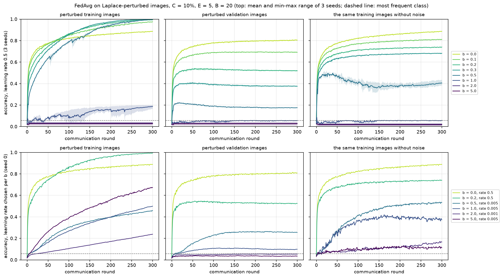{ width=88% }

### Final training and test accuracy against b (item 2)

**Test accuracy on clean images falls from 80.6% without noise to 72.3% at $b = 0.2$, 53.2% at $b = 0.5$, 37.3% at $b = 1$ and 11.4% at $b = 5$. Training accuracy on perturbed images rises from 88.6% at $b = 0$ to 99.8% at $b = 0.5$.** FIG(noise_accuracy) and the table give the values after 300 rounds. Rows with learning rate 0.5 are means of 3 seeds; the other rows are the seed-0 runs with the chosen learning rate.

| $b$ | $\varepsilon$ per pixel | learning rate | training accuracy (perturbed images) | validation accuracy (perturbed images) | training images without noise | test accuracy (clean images) |
|---|---|---|---|---|---|---|
| 0 | none | 0.5 | 0.886 | 0.805 | 0.886 | 0.806 |
| 0.02 | 50 | 0.5 | 0.901 | 0.800 | 0.882 | 0.803 |
| 0.05 | 20 | 0.5 | 0.940 | 0.769 | 0.860 | 0.797 |
| 0.1 | 10 | 0.5 | 0.975 | 0.691 | 0.812 | 0.774 |
| 0.2 | 5 | 0.5 | 0.993 | 0.519 | 0.740 | 0.723 |
| 0.3 | 3.3 | 0.5 | 0.998 | 0.375 | 0.682 | 0.671 |
| 0.5 | 2 | 0.5 | 0.998 | 0.176 | 0.405 | 0.398 |
| 0.5 | 2 | 0.005 | 0.459 | 0.255 | 0.534 | 0.532 |
| 0.75 | 1.3 | 0.5 (unstable) | 0.533 | 0.070 | 0.029 | 0.032 |
| 1 | 1 | 0.5 (unstable) | 0.188 | 0.056 | 0.058 | 0.061 |
| 1 | 1 | 0.005 | 0.500 | 0.099 | 0.373 | 0.373 |
| 1.5 | 0.67 | 0.5 (unstable) | 0.027 | 0.024 | 0.018 | 0.019 |
| 2 | 0.5 | 0.5 (unstable) | 0.032 | 0.029 | 0.022 | 0.021 |
| 2 | 0.5 | 0.001 | 0.239 | 0.053 | 0.167 | 0.161 |
| 3 | 0.33 | 0.5 (unstable) | 0.021 | 0.022 | 0.027 | 0.026 |
| 5 | 0.2 | 0.5 (unstable) | 0.027 | 0.027 | 0.017 | 0.021 |
| 5 | 0.2 | 0.005 | 0.673 | 0.035 | 0.114 | 0.114 |

- **Small noise costs little.** $b = 0.02$ changes test accuracy by 0.003, which is below the standard deviation over seeds (0.004). $b = 0.05$ costs 0.9 points and $b = 0.1$ costs 3.3 points. The standard deviation of test accuracy over seeds is at most 0.007 for $b \le 0.3$ and 0.024 at $b = 0.5$.
- **Training accuracy stops measuring model quality.** The difference between training accuracy on perturbed images and test accuracy is 0.080 at $b = 0$, 0.270 at $b = 0.2$ and 0.600 at $b = 0.5$ ($\eta = 0.5$). At $b = 5$ with learning rate 0.005 the model fits 67.3% of its perturbed training images and 11.4% of the test images.
- **The memorised part is the noise.** For $b \ge 0.2$ the accuracy on the clean versions of the training images exceeds test accuracy by at most 0.017, against 0.080 without noise. The model has no advantage on its own training images once their noise pattern is removed.
- **Perturbed validation accuracy understates accuracy on clean inputs.** At $b = 0.2$ it is 0.519 against 0.723 on the clean test images.
- **The learning rate matters as much as the noise at $b = 0.5$.** Lowering it from 0.5 to 0.005 raises test accuracy from 0.381 to 0.532 for seed 0. A comparison of noise scales at one fixed learning rate would attribute an optimisation failure to the noise.

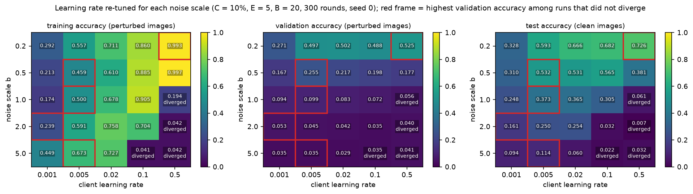{ width=100% }

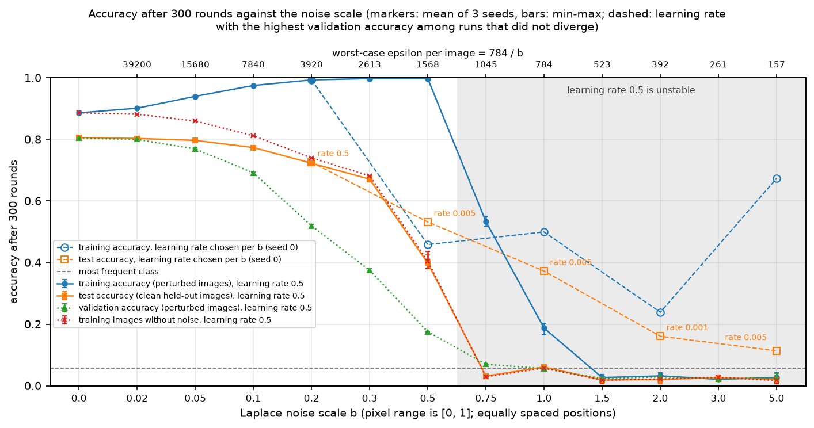{ width=88% }

### Which b to choose (item 3)

**I suggest $b = 1$ with a client learning rate of 0.005, on the condition that the noise is meant to hide the images. No tested $b$ gives both the Part 1 accuracy and that protection.** The table combines the accuracy above with two measured abilities of an observer of the perturbed images (test N4). The observer matches a perturbed image to its original among 2,000 candidate images and reads its label from the matched candidate.

| $b$ | $\varepsilon$ per pixel | $\varepsilon$ for an average pair of images | originals matched among 2,000 | label read | test accuracy |
|---|---|---|---|---|---|
| 0.1 | 10 | 376 | 100% | 100% | 0.774 |
| 0.2 | 5 | 188 | 98.0% | 99.2% | 0.723 |
| 0.5 | 2 | 75 | 76.8% | 85.8% | 0.532 |
| 1 | 1 | 37.6 | 30.0% | 40.8% | 0.373 |
| 2 | 0.5 | 18.8 | 5.8% | 11.2% | 0.161 |
| 5 | 0.2 | 7.5 | 0.0% | 2.8% | 0.114 |

- **Option 1: $b = 0.2$ with the Part 1 hyperparameters.** Test accuracy is 72.3%, which is 8.3 points below training without noise. An observer matches 98% of the perturbed images to their originals, and the per-pixel bound $e^{\varepsilon}$ is $e^{5} = 148$. This option loses 8.3 points of accuracy and hides almost no image.
- **Option 2 (recommended): $b = 1$ with learning rate 0.005.** Test accuracy is 37.3% (seed 0), 6 times the majority-class rate. The per-pixel bound is $e^{1} = 2.7$, and the observer matches 30% of the images.
- **Option 3: $b = 5$ with learning rate 0.005.** The observer matches none of 500 images, and test accuracy is 11.4%.

The reasons for Option 2 are the following.

1. $b = 1$ is the smallest tested scale with $\varepsilon \le 1$ per pixel.
2. The step from $b = 0.5$ to $b = 1$ gives the largest fall in matching per point of accuracy: 47 points of matching for 16 points of test accuracy. The steps from 0.2 to 0.5, from 1 to 2 and from 2 to 5 give 21 for 19, 24 for 21 and 6 for 5.
3. The model at $b = 1$ still learns character shapes: its largest first-layer weight vector is a smooth stroke pattern (FIG(noise_gallery)), and its clean training accuracy equals its test accuracy (0.373).

The suggestion has three limits. The value 37.3% comes from one seed. The protection per image remains weak in formal terms: $\varepsilon = 37.6$ for an average pair, and the best guess between two candidate originals is wrong for 2.3% of pairs only (test N2). An application that needs more than 37% accuracy cannot obtain it from pixel noise at this protection level; noise on clipped model updates is the alternative I would test (last section). If the learning rate must stay at 0.5, training fails for $b \ge 0.75$; $b = 0.3$ then gives 67.1% test accuracy with 93% of the images matched.

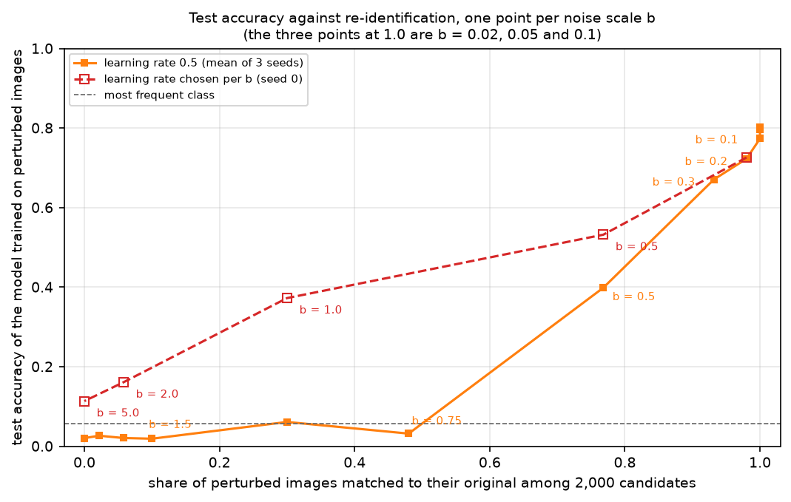{ width=68% }

## Edge cases (Part 2)

- **Scale of $b$.** $b$ is measured on the stored pixel range $[0, 1]$. For pixels stored as 0 to 255, the same noise needs $b$ multiplied by 255.
- **Learning rate.** The input energy grows as $1568\,b^2$, so the Part 1 learning rate diverges for $b \ge 0.75$ (item 1). The comparison of scales needs a learning rate per scale.
- **Clients that diverge.** A client that returns non-finite weights is excluded from the average. When all clients of a round are excluded, the server keeps the previous model. Runs with $b \ge 1.5$ at $\eta = 0.5$ therefore end with finite weights that were last changed before round 9.
- **A model with one answer.** After a partial divergence the output biases dominate the clean inputs, and the model answers one class. Test accuracy is then the share of that class: 6.10% for "O" in all three seeds at $b = 1$, 3.18% for "8" at $b = 0.75$. Identical accuracy in all three seeds indicates this state.
- **Pixels outside $[0, 1]$.** Clipping the perturbed pixels to $[0, 1]$ lowers test accuracy from 0.774 to 0.731 at $b = 0.1$ and from 0.675 to 0.515 at $b = 0.3$ (test N6). The page value is exactly 1 for 88.7% of the pixels, so clipping removes the positive half of their noise and shifts the mean page value by $b/2$. The clean test images do not have this shift. Clipping is a function of the released value, so it leaves the privacy guarantee unchanged.
- **Perturbed validation data.** Validation accuracy on perturbed images is below the majority-class rate (0.058) for $b \ge 2$, so it cannot rank learning rates there. At $b = 2$ it chose learning rate 0.001 (test 0.161), while learning rates 0.005 and 0.02 reach 0.250 and 0.254. Leaving the validation split clean would fix the selection, but each client would then keep using clean images.
- **Early stopping.** Stopping at the round of highest perturbed validation accuracy helps only where $\eta = 0.5$ memorises fastest: at $b = 0.5$ it gives 0.466 clean training accuracy against 0.382 at round 300. For the five runs with chosen learning rates it changes clean training accuracy by $-0.061$ to $+0.004$, so it does not help there.
- **Fewer local epochs.** $E = 1$ at $\eta = 0.5$ gives test accuracy 0.736 against 0.726 at $b = 0.2$, and 0.437 against 0.381 at $b = 0.5$. The gain at $b = 0.5$ is smaller than the gain from the lower learning rate (0.532).
- **$b = 0$.** The noise code with $b = 0$ returns the Part 1 weights bit for bit (test N3). A negative or non-finite $b$ raises an error.
- **Labels and counts.** The noise covers pixels only. Labels, the number of images per client and the class counts of a client are used exactly.

## Tests that validate correctness (Part 2)

**N1. Distribution of the injected noise (`noise_stats`).** The noise is measured as the difference between the perturbed and the clean training tensors, 19,964,560 values per scale. $\mathrm{Laplace}(0, b)$ has mean 0, variance $2b^2$, mean absolute value $b$ and $P(|e| > b) = 1/e = 0.3679$.

| $b$ | mean | variance / $2b^2$ | mean $|e|$ / $b$ | $P(|e| > b)$ | Kolmogorov-Smirnov p-value | correlation with the neighbouring pixel's noise | correlation with the pixel value |
|---|---|---|---|---|---|---|---|
| 0.1 | $-0.00003$ | 1.0001 | 1.0000 | 0.3679 | 0.34 | $-0.0004$ | $+0.0000$ |
| 1 | $+0.00020$ | 1.0002 | 1.0000 | 0.3678 | 0.77 | $-0.0006$ | $+0.0008$ |
| 5 | $+0.00061$ | 1.0006 | 1.0004 | 0.3681 | 0.88 | $+0.0004$ | $-0.0001$ |

All four moments match, the Kolmogorov-Smirnov test on 200,000 sampled values does not reject the Laplace distribution, and the noise is uncorrelated between pixels and with the image. The unit test `test_laplace_noise_properties` checks in addition that one noise seed reproduces the same tensors, that another seed changes them, and that test images and labels are untouched.

**N2. The differential-privacy inequality (`dp_bound`).** For a released image $o$ and two candidate originals $x$ and $x'$, the log-likelihood ratio is $(\lVert o - x' \rVert_1 - \lVert o - x \rVert_1) / b$, and the triangle inequality bounds it by $\lVert x - x' \rVert_1 / b$. I computed the ratio for 20,000 random pairs of training images at seven scales from 0.1 to 100. No pair exceeds the bound, and the largest ratio of loss to bound is 0.94. The share of pairs in which the released image favours the wrong original is 0.1% at $b = 0.5$, 2.3% at $b = 1$, 13.3% at $b = 2$, 31.4% at $b = 5$ and 45.3% at $b = 20$. A share of 50% would mean that the released image carries no information.

**N3. No noise reproduces Part 1 (`noise_checks`).** The run with $b = 0$ through the noise code path and the Part 1 run with seed 0 have identical final weights (`torch.equal`).

**N4. Re-identification (`reident`).** An observer holds 2,000 candidate clean images and one perturbed image of one of them, and names the candidate with the smallest L1 distance, which is the maximum-likelihood guess under Laplace noise. Chance is 0.05%. The prediction is that matching succeeds while the ink energy of an image exceeds a small fraction of the noise energy $1568\,b^2$, because the observer needs to separate 2,000 candidates only. The ratio of ink energy to noise energy is 1.3 at $b = 0.1$, 0.052 at $b = 0.5$ and 0.013 at $b = 1$; the matched shares are 100%, 76.8% and 30.0%, and 0% to 0.6% for $b \ge 5$. The same test feeds perturbed test images to the Part 1 model: it scores 0.525 at $b = 0.2$, 0.357 at $b = 0.3$ and 0.169 at $b = 0.5$. The models trained on perturbed images score 0.519, 0.375 and 0.176 on perturbed validation images. Training on perturbed images therefore does not make the model more accurate on perturbed inputs.

**N5. Stability of the sweep (`noise_checks`).** For every scale the validation file lists the input energy, the number of seeds whose training loss exceeded 20 and the rounds without a server update. It also lists the number of distinct classes that the final model predicts on the test set. The final models predict 49 to 62 classes for $b \le 0.5$, 3 or 4 classes at $b = 0.75$ and one class at $b = 1$. These counts separate "the noise removed the information" from "the optimiser failed", which the accuracy alone does not.

**N6. Variants (`noise_checks`).** Leaving the validation split clean must not change any weight, because validation images never enter training. Measured at $b = 0.1$: training accuracy (0.9759) and test accuracy (0.7735) are identical to the standard run in all printed digits, and validation accuracy becomes 0.775, equal to test accuracy within 0.002. The clipped variant is described under the edge cases.

**N7. Learning rate per noise scale (`noise_checks`).** The validation file `noise_checks.md` holds the table of all 31 runs. The prediction from the input energy is a stability limit on $\eta\, b^2$. The measured limit lies between 0.125 (19 of 19 runs stable) and 0.28 ($b = 0.75$ at $\eta = 0.5$, unstable in 2 of 3 seeds).

## Non-standard plots (Part 2)

**What the client releases and what the model learns (FIG(noise_gallery)).** Each column is one noise scale. Rows 1 to 4 show four training images with noise of that scale, with the prediction of the model trained at that scale. The bottom row shows the first-layer weight vector with the largest norm. The strokes remain visible at $b = 0.3$ and are not visible at $b = 1$, yet the model trained at $b = 1$ classifies two of the four perturbed images correctly. The weight vectors are stroke patterns up to $b = 1$ and unstructured at $b = 2$ and $b = 5$. A single image becomes illegible to the eye near $b = 0.5$, where the L1 matching of test N4 still succeeds for 77% of the images.

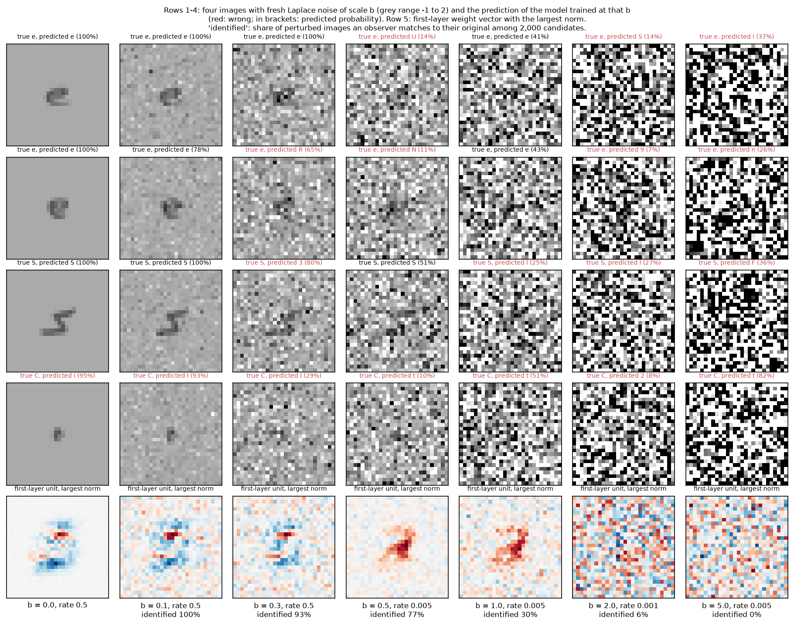{ width=78% }

**Accuracy against re-identification (FIG(privacy_utility)).** This plot replaces the abstract parameter $b$ by a measured privacy outcome on the horizontal axis. A mechanism that protects images at low cost would produce points in the upper left corner. The measured points run from the lower left to the upper right, and the curve with the chosen learning rates lies up to 31 points above the curve at learning rate 0.5.

## With three more months (Part 2)

- **Noise on model updates.** I would implement DP-FedAvg: clip each client update to a fixed norm, add Gaussian noise to the average, and track $\varepsilon$ per client over all rounds with a privacy accountant. I would compare its accuracy with pixel noise at equal re-identification rates.
- **More seeds for the chosen learning rates.** The runs with re-tuned learning rates use one seed. I would run 5 seeds and a finer grid, and test the rule $\eta \propto 1 / (20.8 + 1568\,b^2)$ directly.
- **Fresh noise per epoch.** I would measure whether a new draw in every epoch prevents memorisation, and account for the privacy loss of the repeated releases.
- **Noise-aware models.** Averaging 2 by 2 pixel blocks divides the noise variance by 4. I would test pooled inputs and a small convolutional network at $b = 1$ and $b = 2$.
- **Stronger observers.** The matching test uses 2,000 candidates and L1 distance. I would test all 31,825 candidates, a learned denoiser, and membership-inference and model-inversion attacks on the trained weights.
- **Label protection.** I would add randomized response on the labels and measure the combined loss of accuracy.
- **Normalised inputs.** I would divide the perturbed inputs by their expected norm, which should remove the dependence of the stable learning rate on $b$.
